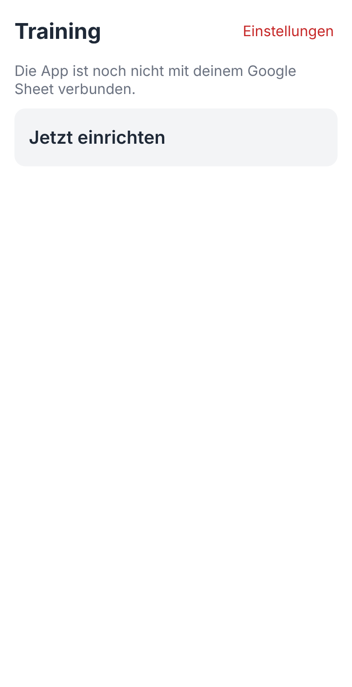
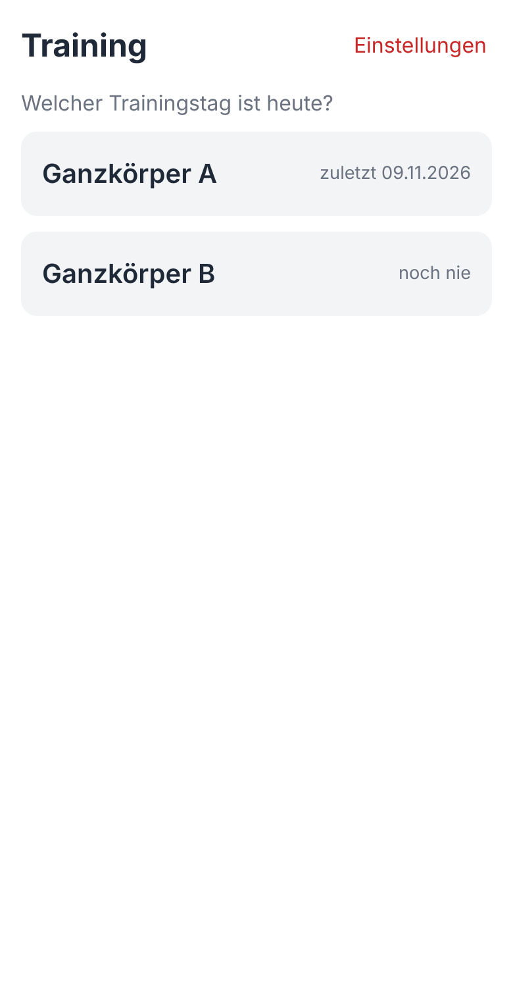

# Trainings-Tracker einrichten

Diese Anleitung richtet deinen eigenen Trainings-Tracker ein. Du brauchst dafür etwa 15 Minuten, einen PC mit Google-Konto und dein iPhone.

Am Ende hast du:

- ein eigenes Google Sheet als Datenbank (nur du siehst deine Daten),
- die App auf dem Home-Bildschirm deines iPhones,
- optional die Excel-Auswertung am PC.

Die Schritte 1 bis 5 machst du am PC, Schritt 6 und 7 am iPhone.

---

## 1. Vorlage kopieren

1. Öffne den Vorlage-Link, den du von Tom bekommen hast.
2. Google fragt „Kopie erstellen?“. Klicke **Kopie erstellen**.
3. Die Kopie liegt jetzt in deinem Google Drive. Benenne sie, wie du willst, zum Beispiel „Mein Training“.

> Arbeite ab jetzt nur noch in deiner Kopie.

## 2. Trainingstage anlegen

Jeder Trainingstag ist ein eigenes Tabellenblatt. Der Name des Reiters unten ist der Name in der App, und er steht nur dort.

1. Den Reiter **Training A** umbenennen (Rechtsklick auf den Reiter → **Umbenennen**), zum Beispiel in `Push` oder `Ganzkörper A`.
2. Für jeden weiteren Tag: Rechtsklick auf einen Tages-Reiter → **Duplizieren**, dann die Kopie umbenennen.
3. Die Reihenfolge der Reiter (mit der Maus ziehen) ist die Reihenfolge der Knöpfe in der App.

Die Übungen pro Tag wählst du später bequem in der App aus.

## 3. Einrichtung ausführen

1. Im Sheet: **Erweiterungen → Apps Script**. Der Script-Editor öffnet sich in einem neuen Tab.
2. Oben in der Leiste im Auswahlfeld neben **Ausführen** die Funktion **setupApi** wählen.
3. Auf **Ausführen** klicken.
4. Beim ersten Mal fragt Google nach Berechtigungen:
   1. **Berechtigungen prüfen** klicken und dein Google-Konto wählen.
   2. Es erscheint „Google hat diese App nicht überprüft“. Das ist normal, das Script stammt aus deiner eigenen Kopie. Klicke **Erweitert** und dann **Zu … wechseln (unsicher)**.
   3. Falls Häkchen angeboten werden: alle setzen. Dann **Zulassen** bzw. **Weiter**.
5. Wechsle zurück zum Tab mit deinem Sheet. Dort steht die Meldung „Fertig. Trainingstage: …“ mit deinen Tagen. Mit **OK** schließen.

## 4. Web-App bereitstellen

Zurück im Tab mit dem Script-Editor:

1. Oben rechts **Bereitstellen → Neue Bereitstellung**.
2. Links neben „Typ auswählen“ auf das Zahnrad klicken und **Web-App** wählen.
3. Ausfüllen:
   - Beschreibung: zum Beispiel `Trainings-App`
   - Ausführen als: **Ich** (deine E-Mail-Adresse)
   - Zugriff: **Jeder**
4. **Bereitstellen** klicken. Falls Google noch einmal nach Berechtigungen fragt, wie in Schritt 3.4 bestätigen.
5. Google zeigt die **Web-App-URL**. Sie beginnt mit `https://script.google.com/` und endet auf `/exec`. Auf **Kopieren** klicken.

> „Zugriff: Jeder“ heißt nur, dass die App dein Script erreichen kann. Ohne deinen persönlichen Schlüssel liefert das Script keine Daten.

## 5. Einrichtungslink erzeugen

1. Im Script-Editor die Funktion **showSetupLink** wählen und **Ausführen** klicken.
2. Wechsle zum Tab mit deinem Sheet. Dort fragt ein Fenster nach der Web-App-Adresse: die kopierte URL aus Schritt 4 einfügen, **OK**.
3. Das Fenster zeigt jetzt deinen **Einrichtungslink**. Ihn komplett markieren und kopieren.
4. Schick dir den Link aufs iPhone, zum Beispiel per Mail an dich selbst oder in die Notizen-App.

> Der Link enthält deinen Schlüssel. Nicht weitergeben und nicht in Gruppen posten.
>
> Den Link kannst du jederzeit wieder mit showSetupLink anzeigen. Die Adresse ist dann schon gespeichert.

## 6. App auf dem iPhone installieren

1. Öffne in **Safari** die App: <https://stadler-tom.github.io/trainings-tracker/>
2. Unten auf **Teilen** (Quadrat mit Pfeil nach oben) tippen.
3. **Zum Home-Bildschirm** wählen und **Hinzufügen** tippen.
4. Ab jetzt die App nur noch über das neue Symbol auf dem Home-Bildschirm öffnen.

## 7. App verbinden

1. Die App über das Symbol auf dem Home-Bildschirm öffnen und **Jetzt einrichten** tippen.
2. Den Einrichtungslink aus Schritt 5 in das oberste Feld **Einrichtungslink** einfügen und **Link übernehmen** tippen.
3. Die App testet die Verbindung und meldet „Verbunden mit …“.
4. **Speichern** tippen.

Die Startseite zeigt jetzt deine Trainingstage.

Wichtig: Den Link in den Einstellungen der App einfügen, nicht in Safari öffnen. Die App auf dem Home-Bildschirm hat einen eigenen Speicher, getrennt von Safari.

**Fertig.** Du kannst trainieren.

---

## So benutzt du die App

- **Trainingstag antippen.** Beim ersten Mal ist der Tag leer: unten über **Übung hinzufügen** deine Übungen wählen. Die Auswahl und Reihenfolge (Pfeile ↑ ↓) bleibt für das nächste Training gespeichert.
- **Ziel heute** sagt dir Gewicht und Wiederholungen. Das Gewicht ist schon eingetragen; die grauen Zahlen in den Satzfeldern sind das Ziel.
- **Satz eintragen:** Feld antippen, Zahl eingeben. Oder **+ / −** benutzen. Ein leeres Feld heißt: Satz nicht gemacht.
- **Gerätenotiz** (z. B. „Sitz 4“) antippen und eintragen. Sie gilt für alle Trainingstage.
- **Scheiben & Aufwärmen** zeigt bei Langhantel-Übungen, welche Scheiben auf jede Seite gehören, und schlägt Aufwärmsätze vor.
- **Training speichern** am Ende. Ein Tag kann pro Datum nur einmal gespeichert werden.
- Schließt sich die App zwischendurch, sind beim nächsten Öffnen alle Eingaben noch da.

## Das Sheet

- **Tagesblätter:** ein Blatt pro Trainingstag, der Reitername ist der Tagesname.
  - **Umbenennen:** nur den Reiter umbenennen. Beim nächsten Öffnen der App steht der neue Name überall, auch bei allen alten Einträgen im Log.
  - **Neuer Tag:** Tagesblatt duplizieren und umbenennen. **Tag entfernen:** Reiter löschen; die alten Einträge im Log bleiben.
  - Änderungen am Sheet sieht die App beim nächsten Öffnen. Ist sie noch im Hintergrund offen, in der App-Übersicht nach oben wischen und neu öffnen.
- **Übungen:** Übungsstamm mit Beispielübungen. Neue Übung = neue Zeile mit neuer ID (z. B. `E28`). Übungen nie löschen, sondern **Aktiv** auf `nein` setzen.
  - Den Namen einer Übung änderst du nur hier, Tagesblätter und App übernehmen ihn. Die **ID** nie ändern: Über sie hängen Verlauf und Tagesauswahl an der Übung.
  - **Gewichtssprung:** Schritt der +/−-Knöpfe, z. B. 2,5 bei Kurzhanteln, 1,25 am Kabel, 5 an Maschinen.
  - **Stangengewicht kg:** aktiviert den Scheibenrechner, z. B. 20 bei der Langhantel, 0 bei der Multipresse (nur Scheiben). Leer = kein Scheibenrechner.
- **Log:** alle gespeicherten Sätze. Korrekturen direkt hier.
- **Körper:** Gewicht und Bauchumfang trägst du direkt im Sheet ein (Google-Sheets-App).

## Excel-Auswertung (optional, am PC)

1. Lade die Datei [Trainings-Auswertung.xlsx](Trainings-Auswertung.xlsx) herunter (auf der Seite **Download** bzw. „Download raw file“).
2. In deinem Google Sheet am PC: **Datei → Freigeben → Im Web veröffentlichen**.
3. Unter **Link** das Blatt **Log** und das Format **Kommagetrennte Werte (.csv)** wählen, **Veröffentlichen**, Link kopieren.
4. Die Excel-Datei öffnen, gegebenenfalls **Bearbeitung aktivieren** und **Inhalt aktivieren**, Blatt **Einstellungen**, Link bei **Log** einfügen.
5. Schritt 3 und 4 für die Blätter **Übungen** und **Körper** wiederholen.
6. In Excel **Daten → Alle aktualisieren**. Fragt Excel nach dem Zugriff auf die Webinhalte: **Anonym** wählen und **Verbinden**.

Danach reicht nach jedem Training **Daten → Alle aktualisieren**.

> Wer einen CSV-Link kennt, kann deine Trainingsdaten lesen. Gib die Excel-Datei mit eingetragenen Links nicht weiter.

## Wenn etwas nicht klappt

| Meldung in der App | Lösung |
| --- | --- |
| Keine Verbindung zum Web-API | Netz prüfen. In der App muss die Adresse auf `/exec` enden. In der Bereitstellung muss „Zugriff: Jeder“ stehen. |
| Die Adresse endet auf /dev | Du hast die Test-Adresse des Editors erwischt. showSetupLink erneut ausführen und die Web-App-URL aus Schritt 4 einfügen. |
| Der Schlüssel ist falsch | Einrichtungslink mit showSetupLink neu anzeigen und in der App erneut übernehmen. |
| Script im Sheet veraltet | Anleitung [Script aktualisieren](UPDATE.md) befolgen. |
| Diesen Trainingstag gibt es im Sheet nicht mehr | Das Tagesblatt wurde gelöscht. In der App „Training verwerfen“ und einen anderen Tag wählen. Ein umbenannter Reiter löst diese Meldung nicht aus. |

setupApi darfst du jederzeit erneut ausführen. Es ergänzt nur, was fehlt, und ändert keine Daten.
