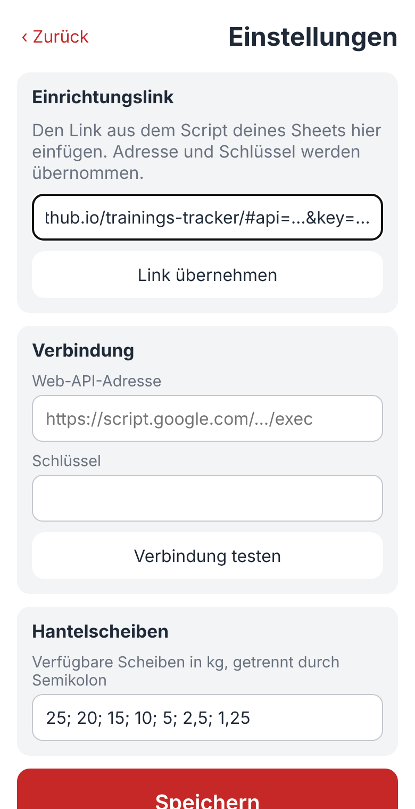
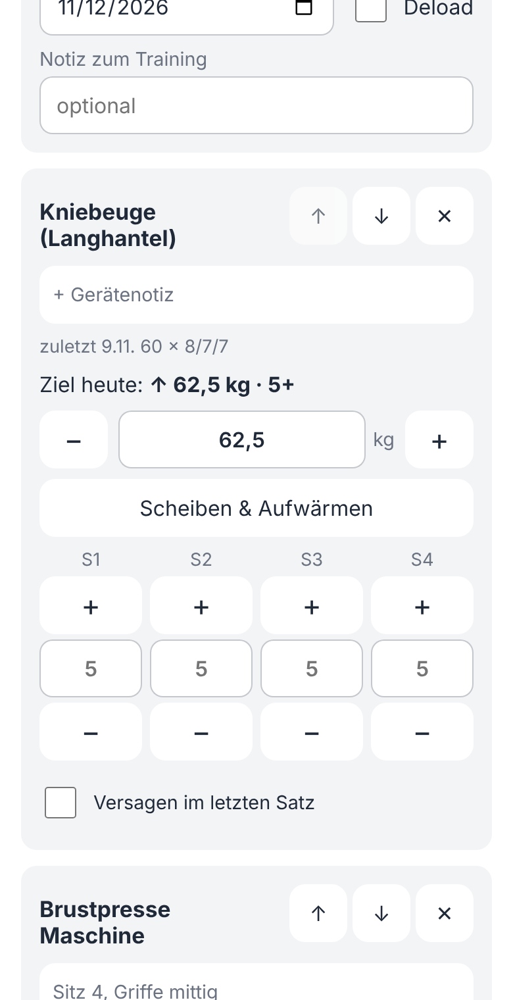

# Trainings-Tracker einrichten

Schön, dass du den Tracker ausprobierst! Mit dieser Anleitung richtest du dir deinen eigenen ein. Plan etwa 15 Minuten ein und leg dir einen PC mit Google-Konto und dein iPhone bereit.

Danach hast du:

- ein eigenes Google Sheet als Datenbank (deine Daten siehst nur du, ich auch nicht),
- die App auf dem Home-Bildschirm deines iPhones,
- die Auswertung am PC als Lesezeichen.

Die Schritte 1 bis 5 machst du am PC, Schritt 6 und 7 am iPhone.

---

## 1. Vorlage kopieren

1. Öffne die Vorlage über diesen Link: <https://docs.google.com/spreadsheets/d/1F4nseZO28sjcrHXs4sTEblvaoVbs5NMU7jBt1EHN4GY/copy>
2. Google fragt „Kopie erstellen?“. Klick auf **Kopie erstellen**.
3. Die Kopie liegt jetzt in deinem Google Drive. Nenn sie, wie du willst, zum Beispiel „Mein Training“.

> Ab jetzt arbeitest du nur noch in deiner Kopie.

## 2. Trainingstage anlegen

Jeder Trainingstag ist ein eigenes Tabellenblatt. Wie der Reiter unten heißt, so heißt der Tag auch in der App. Der Name steht nur dort, sonst nirgends.

1. Den Reiter **Training A** umbenennen (Rechtsklick auf den Reiter → **Umbenennen**), zum Beispiel in `Push` oder `Ganzkörper A`.
2. In **B2** den Wochentag wählen, an dem du diese Einheit trainierst. **B3** ist für einen optionalen zweiten Wochentag. Beides darf auch leer bleiben.
3. Für jeden weiteren Tag: Rechtsklick auf einen Tages-Reiter → **Duplizieren**, dann die Kopie umbenennen und den Wochentag anpassen.
4. Die App sortiert die Tage nach Wochentag, Montag zuerst. Tage ohne Wochentag landen am Ende, in der Reihenfolge der Reiter.

Die Übungen für jeden Tag wählst du ab Zeile 6 aus der Liste aus, oder später bequem in der App. Daneben steht, wie viele Sätze du machst (1 bis 5, Standard 4). Ein Haken in der Spalte **Supersatz** verbindet die Übung mit der nächsten.

## 3. Einrichtung ausführen

1. Im Sheet: **Erweiterungen → Apps Script**. Der Script-Editor öffnet sich in einem neuen Tab.
2. Oben in der Leiste, im Auswahlfeld neben **Ausführen**, die Funktion **setupApi** wählen.
3. Auf **Ausführen** klicken.
4. Beim ersten Mal will Google Berechtigungen:
   1. **Berechtigungen prüfen** klicken und dein Google-Konto wählen.
   2. Jetzt kommt „Google hat diese App nicht überprüft“. Keine Sorge, das ist normal: Das Script stammt aus deiner eigenen Kopie. Klick auf **Erweitert** und dann auf **Zu … wechseln (unsicher)**.
   3. Falls Häkchen angeboten werden, alle setzen. Dann **Zulassen** bzw. **Weiter**.
5. Wechsel zurück zum Tab mit deinem Sheet. Dort steht „Fertig. Trainingstage: …“ mit deinen Tagen. Mit **OK** schließen.

## 4. Web-App bereitstellen

Zurück im Tab mit dem Script-Editor:

1. Oben rechts **Bereitstellen → Neue Bereitstellung**.
2. Links neben „Typ auswählen“ aufs Zahnrad klicken und **Web-App** wählen.
3. Ausfüllen:
   - Beschreibung: zum Beispiel `Trainings-App`
   - Ausführen als: **Ich** (deine E-Mail-Adresse)
   - Zugriff: **Jeder**
4. **Bereitstellen** klicken. Fragt Google noch einmal nach Berechtigungen, bestätigst du wie in Schritt 3.4.
5. Google zeigt dir die **Web-App-URL**. Sie fängt mit `https://script.google.com/` an und hört mit `/exec` auf. Auf **Kopieren** klicken.

> „Zugriff: Jeder“ heißt nur, dass die App dein Script erreichen kann. Ohne deinen persönlichen Schlüssel rückt das Script keine Daten raus.

## 5. Einrichtungslink erzeugen

1. Im Script-Editor die Funktion **showSetupLink** wählen und **Ausführen** klicken.
2. Wechsel zum Tab mit deinem Sheet. Ein Fenster fragt nach der Web-App-Adresse: die kopierte URL aus Schritt 4 einfügen, **OK**.
3. Das Fenster zeigt jetzt zwei Links. Den ersten (**App (Handy)**) komplett markieren und kopieren.
4. Schick dir den Link aufs iPhone, zum Beispiel per Mail an dich selbst oder über die Notizen-App.
5. Den zweiten Link (**PC-Auswertung**) legst du am PC als Lesezeichen an, siehe [Auswertung](#auswertung).

> In beiden Links steckt dein Schlüssel. Also nicht weitergeben und nicht in Gruppen posten.
>
> Du kannst dir die Links jederzeit wieder mit showSetupLink anzeigen lassen. Die Adresse ist dann schon gespeichert.

## 6. App auf dem iPhone installieren

1. Öffne die App in **Safari**: <https://stadler-tom.github.io/trainings-tracker/>
2. Unten auf **Teilen** tippen (Quadrat mit Pfeil nach oben).
3. **Zum Home-Bildschirm** wählen und auf **Hinzufügen** tippen.
4. Ab jetzt öffnest du die App nur noch über das neue Symbol auf dem Home-Bildschirm.

## 7. App verbinden

1. Die App über das Symbol auf dem Home-Bildschirm öffnen und auf **Jetzt einrichten** tippen.
2. Den Einrichtungslink aus Schritt 5 ins oberste Feld **Einrichtungslink** einfügen und auf **Link übernehmen** tippen.
3. Die App testet die Verbindung und meldet „Verbunden mit …“.
4. Auf **Speichern** tippen.

Auf der Startseite siehst du jetzt deine Trainingstage.

Wichtig: Den Link in den Einstellungen der App einfügen, nicht in Safari öffnen. Die App auf dem Home-Bildschirm hat ihren eigenen Speicher, getrennt von Safari.

**Fertig.** Viel Spaß beim Training!

---

## So benutzt du die App

- **Trainingstag antippen.** Ist der Tag noch leer, wählst du unten über **Übung hinzufügen** deine Übungen aus. Auswahl und Reihenfolge (Pfeile ↑ ↓) merkt sich die App fürs nächste Training.
- **Knöpfe:** Hinter dem Namen stehen die Wochentage aus dem Sheet, z. B. „Push (Mo, Do)“. Der Tag für heute ist eingerahmt.
- **Ziel heute** sagt dir, welches Gewicht und wie viele Wiederholungen dran sind. Das Gewicht ist schon eingetragen, die grauen Zahlen in den Satzfeldern sind das Ziel.
- **Satz eintragen:** Feld antippen und die Zahl eingeben, oder **+ / −** benutzen. Eingetragene Sätze werden grün. Ein leeres Feld heißt: Satz nicht gemacht.
- **Supersatz:** 🔗 bei einer Übung antippen, dann bildet sie mit der nächsten einen Supersatz. Beide stehen in einem Rahmen, und der nächste Satz ist markiert: A1 → B1 → A2 → B2. Noch mal 🔗 löst die Verbindung.
- **Drop-Satz:** Unter den Sätzen auf **+ Drop** tippen. Das Gewicht ist 20 % leichter vorbelegt, du trägst die Wiederholungen ein. Bis zu 3 Drops, ✕ entfernt einen. Drops zählen beim Volumen, aber nicht für Ziel, Rekorde und Progression.
- **Gerätenotiz** (z. B. „Sitz 4“): antippen und eintragen. Sie gilt für alle Trainingstage.
- **Scheiben & Aufwärmen** zeigt dir bei Langhantel-Übungen, welche Scheiben auf jede Seite kommen, und schlägt Aufwärmsätze vor.
- **1RM-Test (Maximalversuch):** Haken setzen und Gewicht eintragen. Der Versuch zählt mit 1 Wdh als getestetes 1RM und hat keinen Einfluss auf Ziel, Rekorde und Progression.
- **Rekord:** Schaffst du mit einem höheren Gewicht als je zuvor mindestens die Min-Wdh, gibt es das Rekordbild. Mehr Wiederholungen beim gleichen Gewicht zählen nicht als Rekord.
- **Eingeschränkt (Schmerzen, Abbruch):** Haken setzen, wenn eine Übung nicht normal lief, gern mit Grund. Sie zählt dann nicht für Ziel, Rekorde und Progression, beim Volumen aber schon.
- **Training speichern** drückst du am Ende. Jeden Tag kannst du pro Datum nur einmal speichern.
- Geht die App zwischendurch zu, sind beim nächsten Öffnen alle Eingaben noch da.

## Das Sheet

- **Tagesblätter:** ein Blatt pro Trainingstag, der Reitername ist der Tagesname. In A1 steht `Trainingstag`, das macht das Blatt zum Tagesblatt. In B2 und B3 stehen die Wochentage, ab Zeile 6 Übung, Sätze (1 bis 5) und der Haken für den Supersatz. Trainings speicherst du nur über die App.
  - **Umbenennen:** einfach nur den Reiter umbenennen. Beim nächsten Öffnen der App steht der neue Name überall, auch bei allen alten Einträgen im Log.
  - **Neuer Tag:** Tagesblatt duplizieren und umbenennen. Oder ein leeres Blatt anlegen, in A1 `Trainingstag` schreiben und setupApi ausführen. **Tag entfernen:** Reiter löschen, die alten Einträge im Log bleiben erhalten.
  - Änderungen am Sheet sieht die App beim nächsten Öffnen. Läuft sie noch im Hintergrund, in der App-Übersicht nach oben wischen und neu öffnen.
- **Übungen:** dein Übungsstamm, am Anfang mit Beispielübungen. Neue Übung = neue Zeile mit neuer ID (z. B. `E28`). Übungen bitte nie löschen, sondern **Aktiv** auf `nein` setzen.
  - Den Namen einer Übung änderst du nur hier, Tagesblätter und App übernehmen ihn. Die **ID** nie ändern: Über sie hängen Verlauf und Tagesauswahl an der Übung.
  - **Gewichtssprung:** so weit springen die +/−-Knöpfe, z. B. 2,5 bei Kurzhanteln, 1,25 am Kabel, 5 an Maschinen.
  - **Stangengewicht kg:** schaltet den Scheibenrechner ein, z. B. 20 bei der Langhantel, 0 bei der Multipresse (nur Scheiben). Leer = kein Scheibenrechner.
- **Muskelgruppen:** jede Gruppe genau einmal, mit **Sätze/Woche Min** und **Max** als Ziel für die Seite Volumen. Im Blatt Übungen wählst du die Gruppe dann aus einer Liste.
  - **Umbenennen:** nur hier. Die Übungen ziehen automatisch nach. **Neue Gruppe:** neue Zeile, die (ausgeblendete) Spalte ID bleibt leer.
- **Log:** alle gespeicherten Sätze. Korrigieren kannst du direkt hier. Spalte **1RM-Test**: 1 = echter Maximalversuch. Spalte **Eingeschränkt**: Grund oder „ja“, leer = normal. Spalte **Drop**: 1, 2, 3 = Drop-Satz nach dem letzten Satz.
- **Einstellungen:** u. a. **Gewicht pro Satz** (ja/nein). Mit „ja“ hat jeder Satz in der App ein eigenes Gewichtsfeld, und das Ziel gilt pro Satz. Alle Werte kannst du auch in der App unter *Einstellungen → Globale Einstellungen* ändern.
- **Körper:** Gewicht und Bauchumfang trägst du in der App unter **Körper** ein, oder direkt hier im Sheet.

## Auswertung

Die Auswertung ist eine eigene Seite der App für den PC. Dort findest du eine Übersicht aller Übungen, den Verlauf je Übung, das Volumen je Muskelgruppe und deine Körperwerte. Sie liest nur und ändert nichts im Sheet.

1. Im Script-Editor **showSetupLink** ausführen (siehe Schritt 5).
2. Den zweiten Link (**PC-Auswertung**) kopieren und im Browser als **Lesezeichen** anlegen.
3. Lesezeichen öffnen. Wenn du synchronisierte Lesezeichen nutzt (Chrome, Edge, Firefox), klappt es danach auf jedem PC ohne weiteren Schritt.

Unten links wählst du das Farbschema. Nach einem Training einfach auf **Neu laden** klicken.

## Wenn etwas nicht klappt

| Meldung in der App | Lösung |
| --- | --- |
| Keine Verbindung zum Web-API | Netz prüfen. In der App muss die Adresse auf `/exec` enden. In der Bereitstellung muss „Zugriff: Jeder“ stehen. |
| Die Adresse endet auf /dev | Da hast du die Test-Adresse des Editors erwischt. showSetupLink noch einmal ausführen und die Web-App-URL aus Schritt 4 einfügen. |
| Der Schlüssel ist falsch | Einrichtungslink mit showSetupLink neu anzeigen und in der App noch einmal übernehmen. |
| Script im Sheet veraltet | Der Anleitung [Script aktualisieren](UPDATE.md) folgen. |
| Diesen Trainingstag gibt es im Sheet nicht mehr | Das Tagesblatt wurde gelöscht. In der App „Training verwerfen“ wählen und einen anderen Tag nehmen. Ein umbenannter Reiter löst diese Meldung nicht aus. |

setupApi kannst du jederzeit noch einmal ausführen. Es ergänzt nur, was fehlt, und ändert keine Daten.

Hängst du trotzdem irgendwo fest, schreib mir einfach.
